# Projet — E-Bank Microservices App

Application bancaire basée sur une architecture microservices Spring Cloud, avec un front Angular et un agent IA (Spring AI + MCP) capable de répondre à des questions sur les clients et les comptes.

## Sommaire

1. [Architecture](#architecture)
2. [Technologies](#technologies)
3. [Lancer le projet](#lancer-le-projet)
4. [Captures d'écran](#captures-décran)
   - [Annuaire Eureka](#1-annuaire-eureka)
   - [Front Angular : toutes les entrées du menu](#2-front-angular--toutes-les-entrées-du-menu)
   - [API à travers la gateway](#3-api-à-travers-la-gateway)
   - [Documentation Swagger](#4-documentation-swagger)
   - [Console H2](#5-console-h2)
5. [Tolérance aux pannes](#tolérance-aux-pannes)
6. [Agent IA et MCP](#agent-ia-et-mcp)

## Architecture

```
                      ┌──────────────────────┐
                      │  angular-front :4200 │
                      └──────────┬───────────┘
                                 │ HTTP
                      ┌──────────▼───────────┐
                      │ gateway-service :9999│
                      └──────────┬───────────┘
            ┌────────────────────┼─────────────────────┐
            │                    │                     │
┌───────────▼──────────┐ ┌───────▼──────────┐ ┌────────▼─────────┐
│ customer-service     │ │ ebank-service    │ │ ebank-bot :8058  │
│ :8056  (H2)          │◄┤ :8057  (H2)      │ │ Spring AI + MCP  │
└───────────┬──────────┘ └───────┬──────────┘ └────────┬─────────┘
            │   OpenFeign + Resilience4j               │ client MCP
            └────────────────────┴─────────────────────┘
                                 │ enregistrement
                      ┌──────────▼───────────┐
                      │discovery-service:8761│
                      └──────────────────────┘
```

| Module | Port | Rôle |
|---|---|---|
| `discovery-service` | 8761 | Annuaire Eureka : chaque service s'y enregistre au démarrage. |
| `customer-service` | 8056 | Gestion des clients (JPA + H2). Expose une API REST et des outils MCP. |
| `ebank-service` | 8057 | Gestion des comptes bancaires. Récupère le client de chaque compte auprès de `customer-service` via OpenFeign. |
| `gateway-service` | 9999 | Point d'entrée unique. Les routes sont créées dynamiquement à partir d'Eureka (`/NOM-DU-SERVICE/...`). |
| `ebank-bot` | 8058 | Agent IA : chat REST, bot Telegram et bot Discord. Utilise les outils MCP des deux services métier. |
| `angular-front` | 4200 | Interface web : liste des comptes et chat avec l'agent. |

## Technologies

- Java 21, Spring Boot 4.1.2, Maven (projet multi-modules)
- Spring Cloud : Eureka, Gateway (WebFlux), OpenFeign, Resilience4j
- Spring Data JPA, base H2 en mémoire, Lombok
- springdoc-openapi (Swagger UI)
- Spring AI : serveur MCP (`@McpTool`), client MCP, modèle OpenAI `gpt-4o`
- Angular 21, Bootstrap 5, ngx-markdown

## Lancer le projet

Les services doivent démarrer dans cet ordre, chacun dans son propre terminal :

```bash
cd discovery-service && ./mvnw spring-boot:run     # 1. annuaire
cd customer-service  && ./mvnw spring-boot:run     # 2. clients
cd ebank-service     && ./mvnw spring-boot:run     # 3. comptes
cd gateway-service   && ./mvnw spring-boot:run     # 4. gateway
cd angular-front     && npm install && npm start   # 5. front
```

Le bot a besoin de quatre variables d'environnement avant son démarrage :

```bash
export OPENAI_API_KEY=...
export DISCORD_TOKEN=...
export TELEGRAM_TOKEN=...
export TELEGRAM_USERNAME=...
cd ebank-bot && ./mvnw spring-boot:run             # 6. agent IA
```

Sans ces variables, `ebank-bot` ne démarre pas ; le reste de l'application fonctionne normalement.

## Captures d'écran

Les captures ci-dessous ont été prises sur l'application en cours d'exécution, sans le bot.

### 1. Annuaire Eureka

`http://localhost:8761/`

Le tableau de bord Eureka liste les instances enregistrées. On y retrouve `CUSTOMER-SERVICE`, `EBANK-SERVICE` et `GATEWAY-SERVICE` à l'état `UP`. C'est grâce à cet annuaire que la gateway et le client Feign trouvent l'adresse des services sans qu'elle soit écrite dans le code.

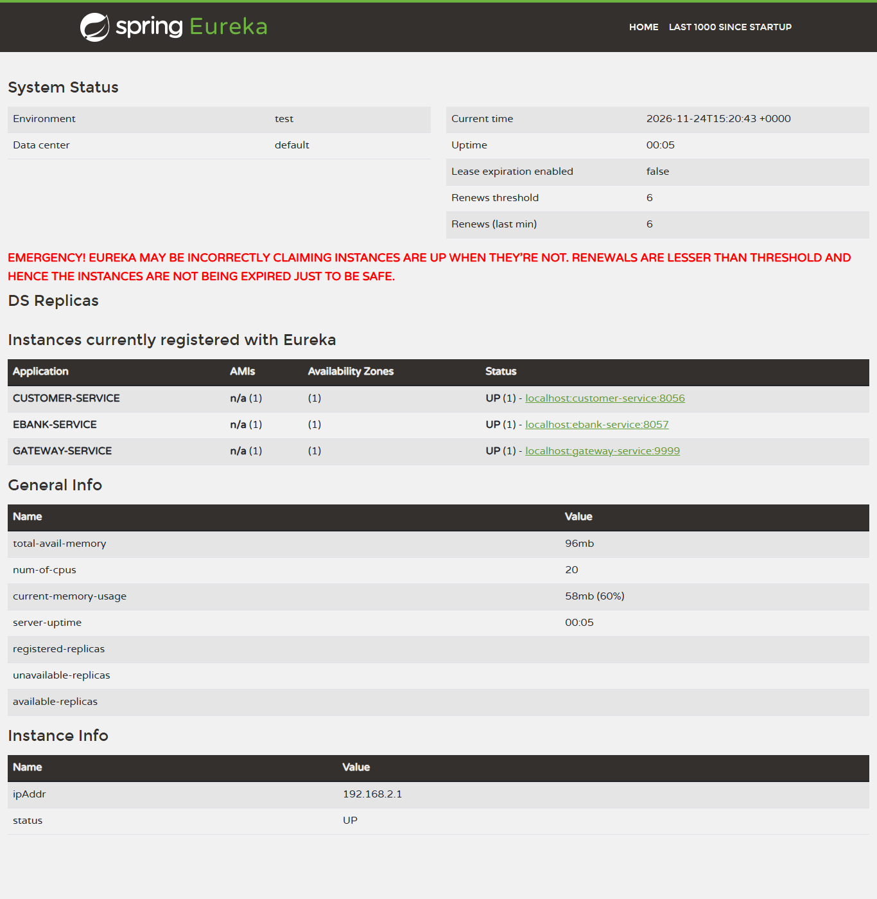

### 2. Front Angular : toutes les entrées du menu

La barre de navigation contient cinq entrées. Deux seulement mènent à une vraie page (`Accounts` et `ChatBot`) ; les autres viennent du modèle de navbar Bootstrap.

#### Home

`http://localhost:4200/`

Page d'accueil. Aucune route n'est définie pour `/`, la zone de contenu est donc vide sous la barre de navigation.

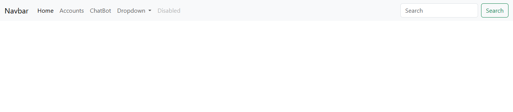

#### Accounts

`http://localhost:4200/accounts`

Liste des comptes bancaires. Le composant appelle `http://localhost:9999/EBANK-SERVICE/accounts` (donc à travers la gateway) et affiche l'identifiant, le solde, la date de création, le type et l'identifiant du client. Un intercepteur HTTP affiche un indicateur de chargement pendant la requête, et un message d'erreur remplace le tableau si l'appel échoue.

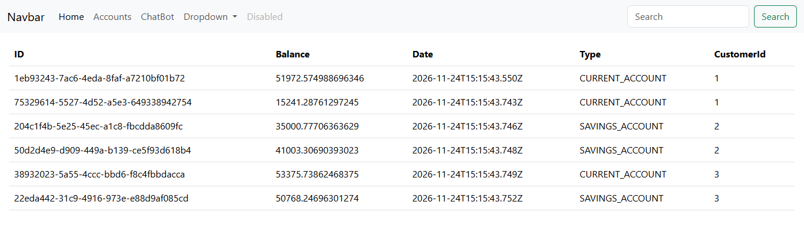

#### ChatBot

`http://localhost:4200/bot`

Interface de discussion avec l'agent IA : un champ de saisie et un bouton d'envoi. La réponse arrive en flux (`/EBANK-BOT/chatStream`) et s'affiche au fur et à mesure, formatée en Markdown. La capture montre l'interface seule : le bot n'était pas démarré, faute de clé OpenAI.

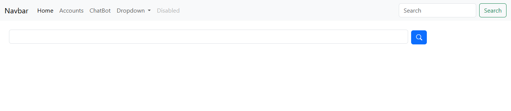

#### Dropdown

Menu déroulant du modèle Bootstrap (`Action`, `Another action`, `Something else here`). Ses entrées ne sont reliées à aucune page.

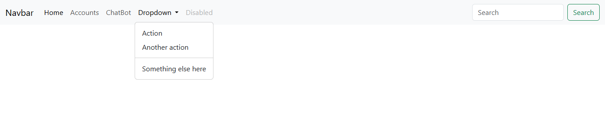

#### Disabled

Entrée désactivée du modèle Bootstrap, visible en gris dans les captures ci-dessus. Elle n'est pas cliquable.

### 3. API à travers la gateway

La gateway crée une route par service enregistré dans Eureka. L'URL a la forme `http://localhost:9999/NOM-DU-SERVICE/chemin`.

#### Liste des comptes

`GET http://localhost:9999/EBANK-SERVICE/accounts`

Chaque compte contient un objet `customer`. Ce champ n'est pas stocké dans la base de `ebank-service` (il est marqué `@Transient`) : il est rempli à chaque requête par un appel Feign à `customer-service`.

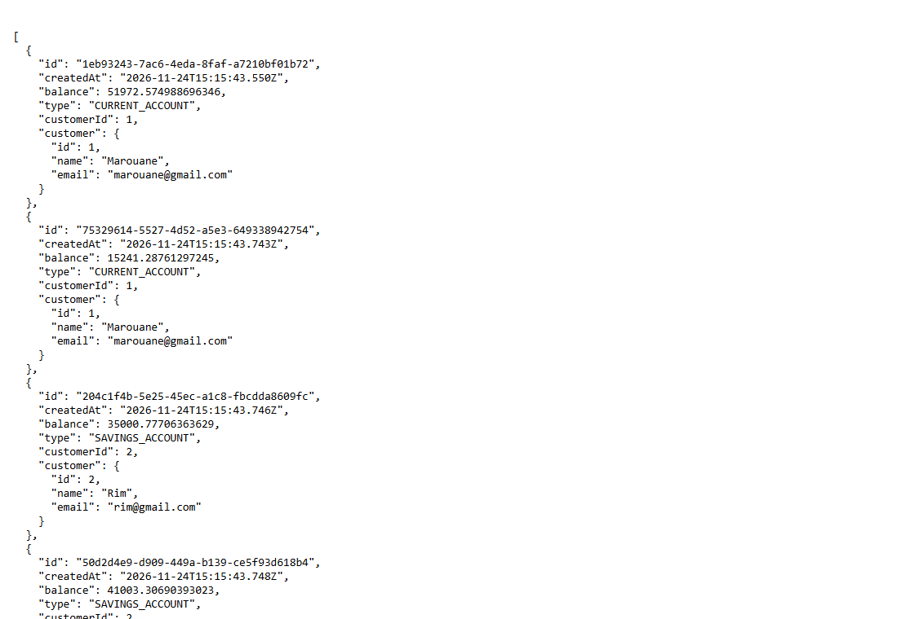

#### Un compte par identifiant

`GET http://localhost:9999/EBANK-SERVICE/accounts/{id}`

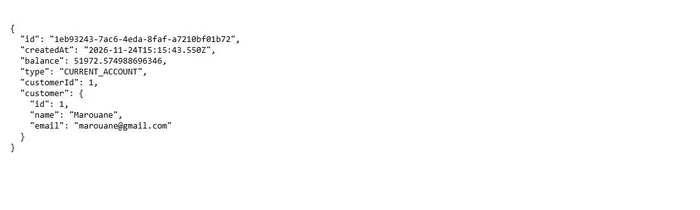

#### Liste des clients

`GET http://localhost:9999/CUSTOMER-SERVICE/customers`

Trois clients sont créés au démarrage par un `CommandLineRunner`.

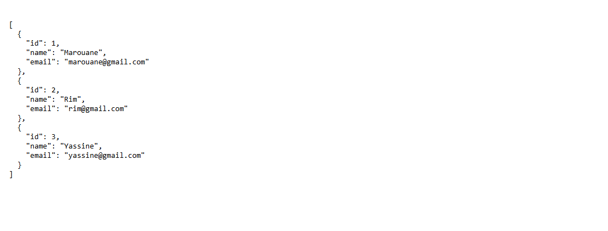

### 4. Documentation Swagger

Chaque service métier publie sa documentation OpenAPI grâce à springdoc.

#### customer-service

`http://localhost:8056/swagger-ui/index.html`

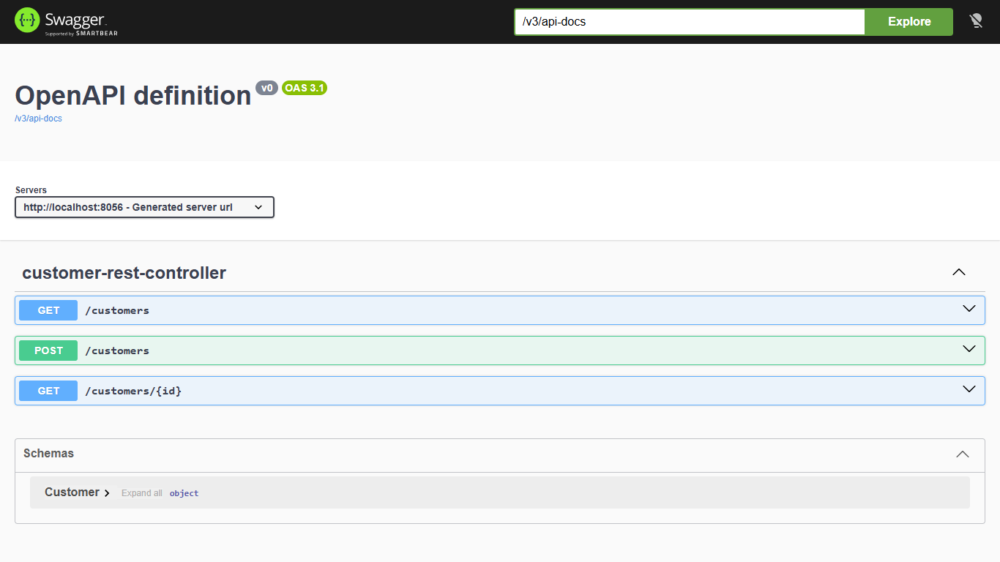

#### ebank-service

`http://localhost:8057/swagger-ui/index.html`

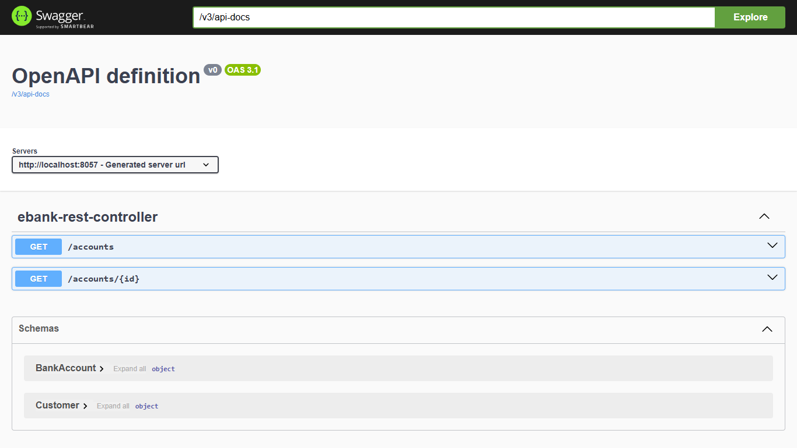

### 5. Console H2

`http://localhost:8056/h2-console` — URL JDBC : `jdbc:h2:mem:customers-db`, utilisateur `sa`, sans mot de passe.

La table `CUSTOMER` est créée automatiquement par Hibernate à partir de l'entité. La base de `ebank-service` est accessible de la même façon sur le port 8057 avec l'URL `jdbc:h2:mem:accounts-db`.

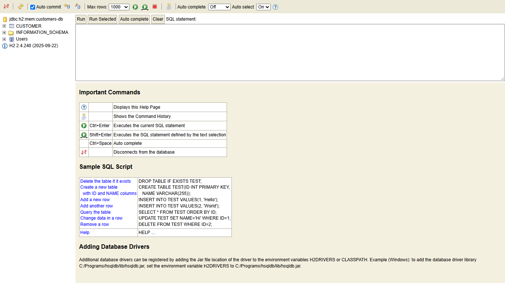

## Tolérance aux pannes

L'appel de `ebank-service` vers `customer-service` est protégé par un disjoncteur Resilience4j :

```java
@FeignClient(name = "customer-service")
public interface CustomerRestClient {
    @GetMapping("/customers/{id}")
    @CircuitBreaker(name = "customerServiceCB", fallbackMethod = "getDefaultCustomer")
    Customer getCustomerById(@PathVariable Long id);

    default Customer getDefaultCustomer(Long id, Exception exception) {
        return Customer.builder().id(id).name("Not Available").email("Not Available").build();
    }
}
```

Si `customer-service` est injoignable, la liste des comptes reste disponible et le client est remplacé par `Not Available`. Ce comportement se voit aussi pendant les premières dizaines de secondes après le démarrage, tant que `ebank-service` n'a pas encore reçu d'Eureka l'adresse de `customer-service`.

## Agent IA et MCP

Les deux services métier sont aussi des serveurs MCP (protocole `streamable`, point d'accès `/mcp`). Leurs méthodes de service sont publiées comme outils avec `@McpTool` :

| Service | Outils MCP |
|---|---|
| `customer-service` | lister les clients, chercher un client par id, enregistrer un client |
| `ebank-service` | lister les comptes, chercher un compte par id, enregistrer un compte |

`ebank-bot` se connecte aux deux serveurs en tant que client MCP et donne ces outils au modèle `gpt-4o`. Le prompt système lui impose de répondre uniquement à partir des résultats des outils, et de répondre « JE NE SAIS PAS » sinon. Une mémoire de conversation (`ChatMemory`) est conservée par `conversationId`.

L'agent est accessible de trois façons :

- REST : `GET /chat?query=...` (réponse complète) et `GET /chatStream?query=...` (réponse en flux), utilisés par la page ChatBot du front ;
- Telegram : `TelegramBot` relaie chaque message reçu à l'agent ;
- Discord : `DiscordBot` fait de même pour les messages Discord.
