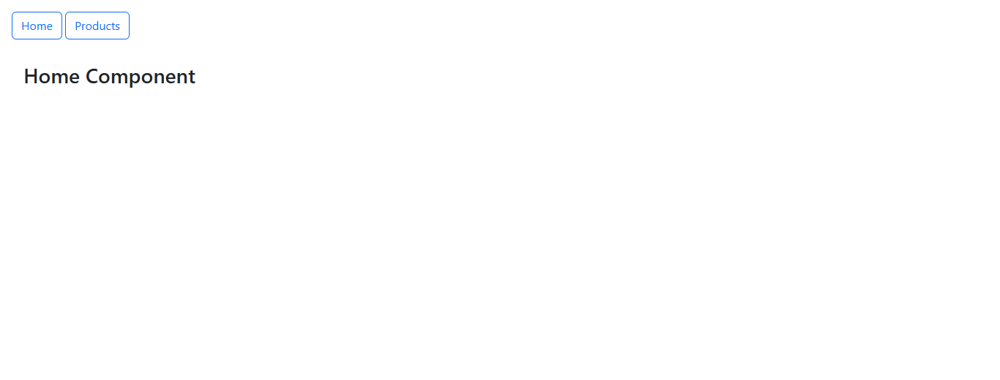
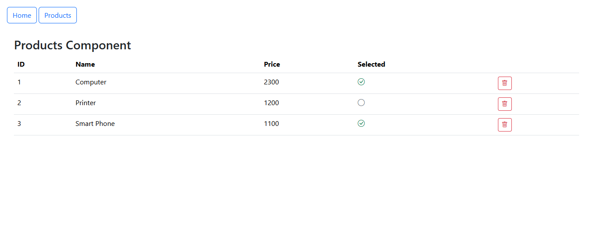
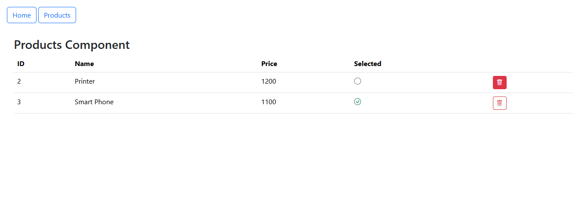
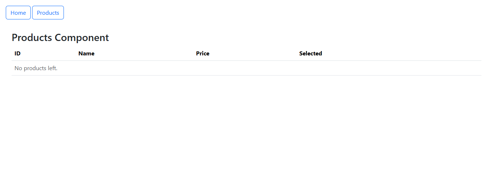

# Activité Pratique N°3 — Application Angular

## Objectif

Prendre en main Angular en construisant une petite application à deux pages : une page d'accueil et une page de gestion de produits. L'activité couvre les composants autonomes (standalone), le routage, les services injectables et la nouvelle syntaxe de contrôle des templates (`@if`, `@for`).

## Technologies

- Angular 21 (composants standalone)
- TypeScript
- Bootstrap 5 et Bootstrap Icons
- Vitest pour les tests unitaires

## Structure du projet

```
src/app
├── app.ts / app.html      Composant racine : barre de navigation + <router-outlet>
├── app.routes.ts          Définition des routes
├── app.config.ts          Configuration de l'application (router)
├── home/                  Composant Home
├── products/              Composant Products (tableau des produits)
└── services/product.ts    Service Product (données et suppression)
```

## Lancer le projet

```bash
npm install
npm start
```

L'application est accessible sur `http://localhost:4200/`. Elle n'a besoin d'aucun backend : les produits sont stockés en mémoire dans le service.

## Routage

```ts
export const routes: Routes = [
  { path: '', redirectTo: 'home', pathMatch: 'full' },
  { path: 'home', component: Home },
  { path: 'prods', component: Products }
];
```

La racine `/` redirige vers `/home`. Les deux boutons de la barre de navigation utilisent `routerLink` : le changement de page se fait sans rechargement du navigateur.

## Captures d'écran

La barre de navigation contient deux entrées, `Home` et `Products`. Chacune est présentée ci-dessous.

### Home

`http://localhost:4200/home`

Page d'accueil, affichée par défaut. Elle contient uniquement le titre du composant `Home`.



### Products

`http://localhost:4200/prods`

Tableau des produits fournis par le service `Product` : identifiant, nom, prix, et un indicateur `Selected` (icône verte cochée si le produit est sélectionné, cercle gris sinon). Chaque ligne a un bouton de suppression.



### Products — suppression d'un produit

Un clic sur le bouton corbeille ouvre une demande de confirmation (`confirm`). Après validation, le composant appelle `deleteProduct` sur le service puis recharge la liste. Ici le produit `Computer` a été supprimé.



### Products — liste vide

Quand tous les produits ont été supprimés, le bloc `@else` du template affiche le message « No products left. » à la place des lignes.



## Points techniques

### Service injectable

Les données sont dans un service déclaré avec `providedIn: 'root'`, donc partagé par toute l'application :

```ts
@Injectable({ providedIn: 'root' })
export class Product {
  private products: ProductItem[] = [
    { id: 1, name: 'Computer', price: 2300, selected: true },
    { id: 2, name: 'Printer', price: 1200, selected: false },
    { id: 3, name: 'Smart Phone', price: 1100, selected: true }
  ];

  getAllProducts(): ProductItem[] { return this.products; }

  deleteProduct(product: ProductItem): void {
    this.products = this.products.filter((p) => p.id !== product.id);
  }
}
```

Comme la liste vit en mémoire, les produits supprimés reviennent quand on recharge la page.

### Syntaxe de contrôle des templates

Le tableau utilise `@for` avec `track p.id` pour parcourir les produits, et `@if` / `@else` pour choisir l'icône et pour gérer la liste vide :

```html
@for (p of products; track p.id) {
  <tr>
    <td>{{ p.id }}</td>
    <td>{{ p.name }}</td>
    <td>{{ p.price }}</td>
    <td>
      @if (p.selected) {
        <i class="bi bi-check-circle text-success"></i>
      } @else {
        <i class="bi bi-circle text-secondary"></i>
      }
    </td>
  </tr>
}
```

## Autres commandes

```bash
npm run build   # build de production dans dist/
npm test        # tests unitaires
```
