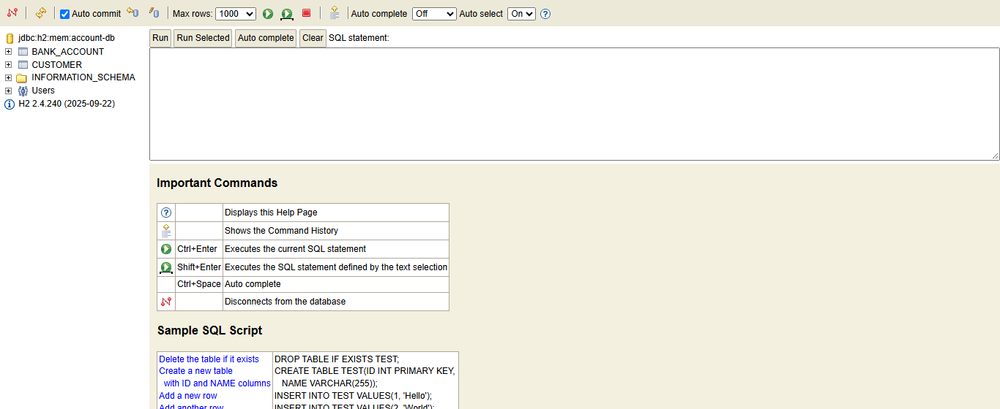
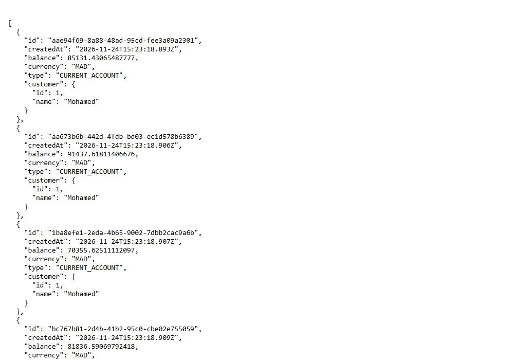
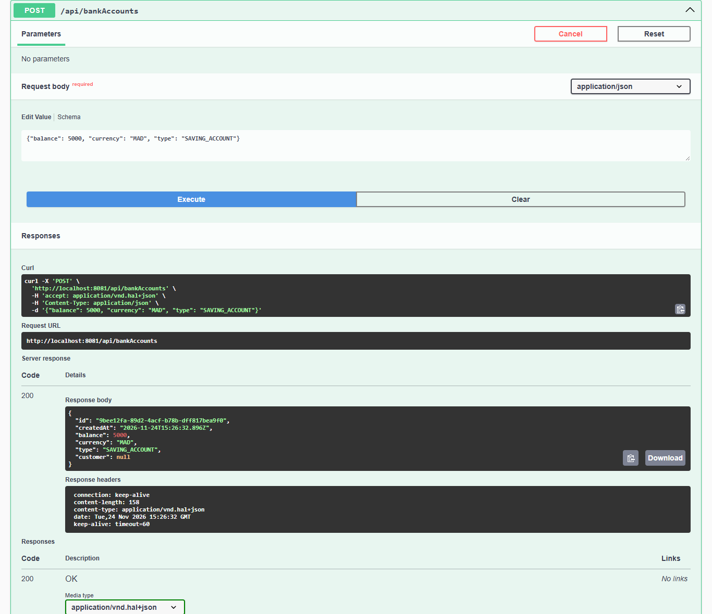
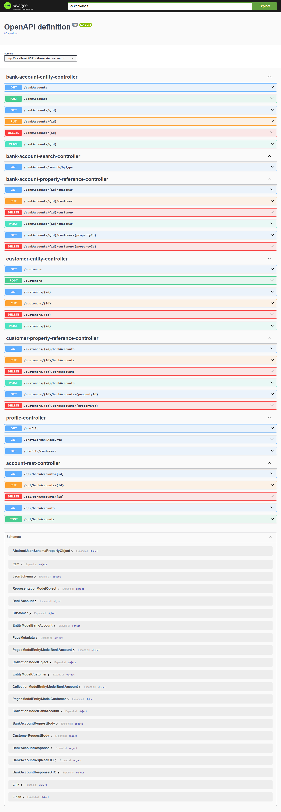
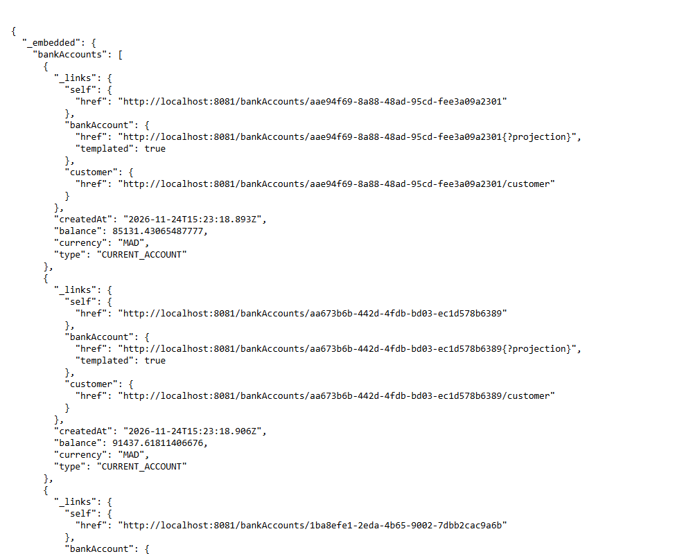
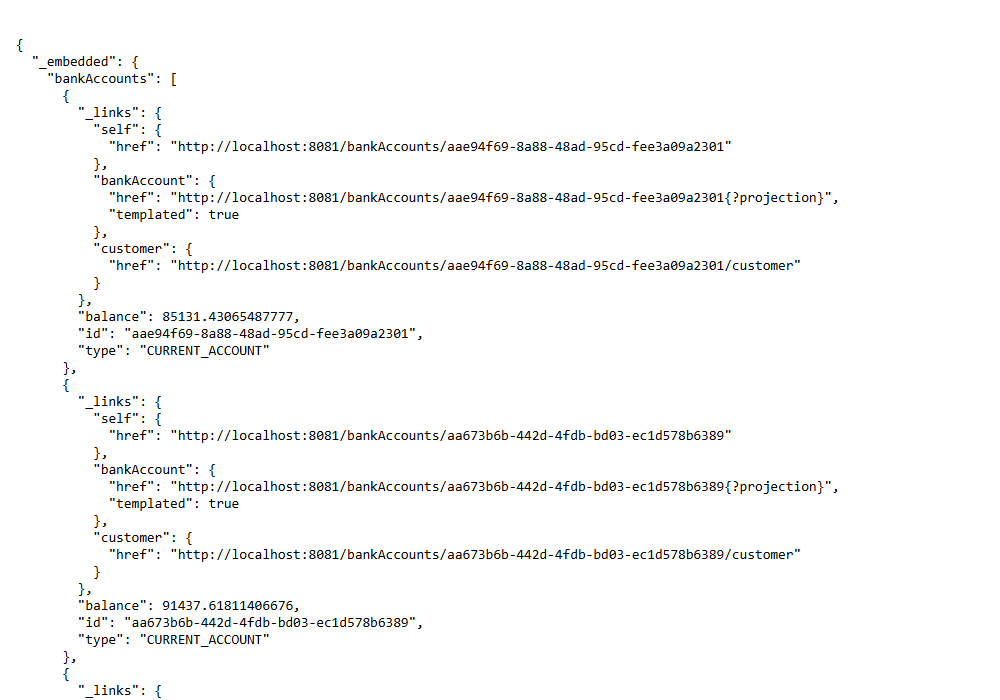
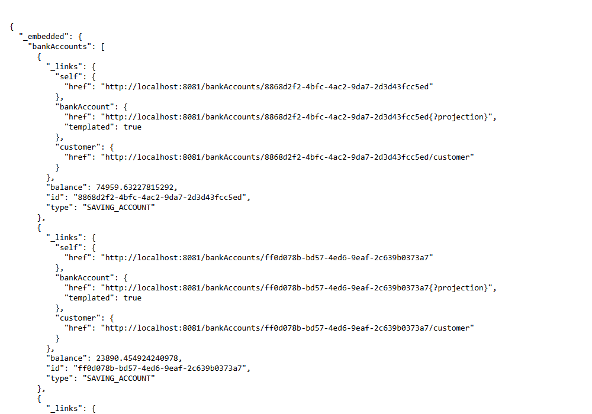
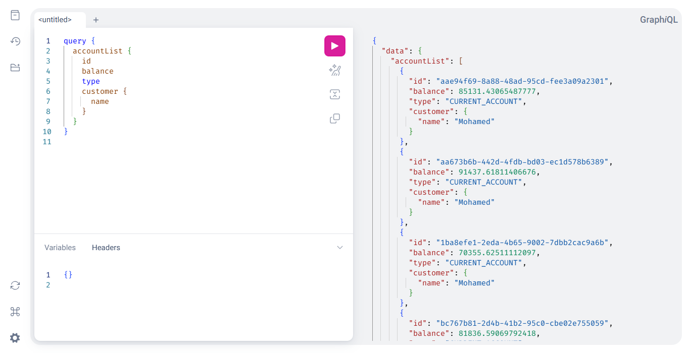
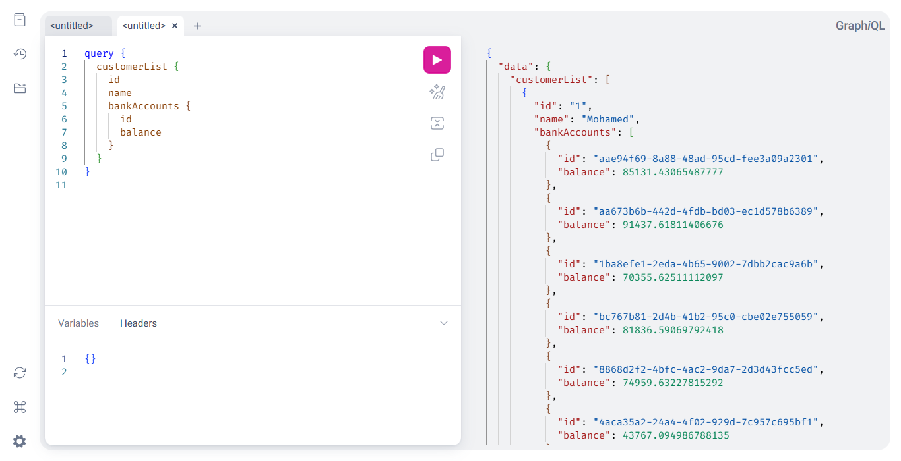
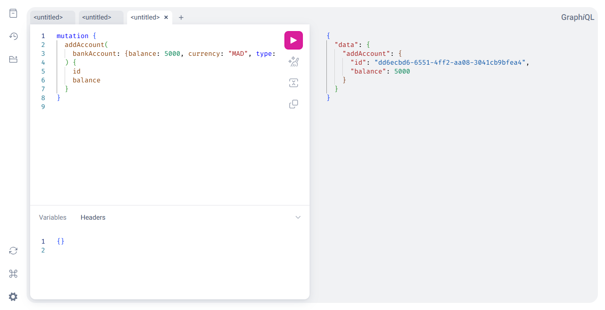

# Activité Pratique N°1 — Microservice Bank Account avec Spring Boot

## Objectif

Développer un microservice de gestion de comptes bancaires avec Spring Boot, exposé de plusieurs façons :

- une API REST classique (contrôleur + couche service + DTOs),
- une API générée automatiquement avec Spring Data REST (avec projections),
- une documentation Swagger / OpenAPI,
- un service web GraphQL.

## Technologies

- Java 17, Spring Boot 4.1.1, Maven
- Spring Web MVC, Spring Data JPA, Spring Data REST, Spring HATEOAS
- Base de données H2 (en mémoire)
- Lombok
- Spring for GraphQL (+ GraphiQL)
- springdoc-openapi (Swagger UI)

## Architecture du projet

```
org.sid.bank_account_service
├── dto/           BankAccountRequestDTO, BankAccountResponseDTO
├── entities/      BankAccount, Customer, AccountProjection
├── enums/         AccountType
├── exceptions/    CustomDataFetcherExceptionResolver
├── mappers/       BankAccountMapper
├── repositories/  BankAccountRepository, CustomerRepository
├── service/       AccountService, AccountServiceImpl
├── web/           AccountRestController, BankAccountGraphQLController
└── BankAccountServiceApplication
resources/
├── application.properties
└── graphql/schema.graphqls
```

## Lancer le projet

```bash
./mvnw spring-boot:run
```

Le service démarre sur le port 8081. Les interfaces disponibles :

| Interface | URL |
|---|---|
| Swagger UI | http://localhost:8081/swagger-ui/index.html |
| GraphiQL | http://localhost:8081/graphiql?path=/graphql |
| Console H2 | http://localhost:8081/h2-console |
| API REST | http://localhost:8081/api/bankAccounts |
| Spring Data REST | http://localhost:8081/bankAccounts |

## 1. Création du projet

Le projet a été généré avec Spring Initializr avec les dépendances : Spring Web, Spring Data JPA, H2 Database, Lombok et Spring for GraphQL. Les dépendances Spring Data REST, Spring HATEOAS et springdoc-openapi ont été ajoutées ensuite dans le `pom.xml`.

## 2. Entités JPA et repositories

- `BankAccount` : `id` (UUID), `createdAt`, `balance`, `currency`, `type` (enum `AccountType` : `SAVING_ACCOUNT` / `CURRENT_ACCOUNT`) et une relation `@ManyToOne` vers `Customer`.
- `Customer` : `id`, `name` et une relation `@OneToMany(mappedBy = "customer")` vers `BankAccount`. L'annotation `@JsonProperty(access = WRITE_ONLY)` évite la récursivité infinie lors de la sérialisation JSON.
- `BankAccountRepository` et `CustomerRepository` héritent de `JpaRepository`.

Au démarrage, un `CommandLineRunner` crée 4 clients et 10 comptes par client.

Configuration (`application.properties`) :

```properties
server.port=8081
spring.datasource.url=jdbc:h2:mem:account-db
spring.h2.console.enabled=true
spring.graphql.graphiql.enabled=true
```

Console H2 (`http://localhost:8081/h2-console`, URL JDBC `jdbc:h2:mem:account-db`) — les tables `BANK_ACCOUNT` et `CUSTOMER` sont bien créées :



## 3. Couche service, DTOs et mapper

- `BankAccountRequestDTO` : données envoyées par le client (`balance`, `currency`, `type`).
- `BankAccountResponseDTO` : données renvoyées (`id`, `createdAt`, `balance`, `currency`, `type`, `customer`).
- `BankAccountMapper` : conversion Entité ↔ DTO.
- `AccountService` / `AccountServiceImpl` (`@Service @Transactional`) : `accountList`, `accountById`, `addAccount`, `updateAccount`, `deleteAccount`.

## 4. API REST (AccountRestController)

Le contrôleur est mappé sur `/api` pour éviter les conflits avec les endpoints générés par Spring Data REST.

| Méthode | Endpoint | Description |
|---|---|---|
| GET | `/api/bankAccounts` | Liste des comptes |
| GET | `/api/bankAccounts/{id}` | Compte par id |
| POST | `/api/bankAccounts` | Ajouter un compte |
| PUT | `/api/bankAccounts/{id}` | Modifier un compte |
| DELETE | `/api/bankAccounts/{id}` | Supprimer un compte |

Liste des comptes (`http://localhost:8081/api/bankAccounts`) — chaque compte contient son client :



## 5. Test de l'ajout d'un compte

Ajout d'un compte — `POST /api/bankAccounts` avec le body JSON :

```json
{"balance": 5000, "currency": "MAD", "type": "SAVING_ACCOUNT"}
```

La requête est envoyée ici depuis Swagger UI (bouton « Try it out »), elle peut l'être de la même façon depuis Postman. Le compte est créé avec un `id` et une date `createdAt` générés automatiquement (réponse `200`). Le champ `customer` vaut `null` car le DTO de requête ne contient pas de client :



## 6. Documentation Swagger

Dépendance ajoutée (version 3.x compatible Spring Boot 4) :

```xml
<dependency>
    <groupId>org.springdoc</groupId>
    <artifactId>springdoc-openapi-starter-webmvc-ui</artifactId>
    <version>3.0.0</version>
</dependency>
```

Remarque : avec Spring Boot 4, springdoc combiné à Spring Data REST nécessite aussi `spring-boot-starter-hateoas`, sinon l'application ne démarre pas (`HateoasProperties not present`).

Documentation accessible sur `http://localhost:8081/swagger-ui/index.html`. On y retrouve le contrôleur écrit à la main (`account-rest-controller`) et les contrôleurs générés par Spring Data REST :



## 7. Spring Data REST et projections

L'annotation `@RepositoryRestResource` expose automatiquement le repository en API REST (format HAL). Une méthode de recherche personnalisée est ajoutée :

```java
@RestResource(path = "/byType")
List<BankAccount> findByType(@Param("t") AccountType type);
```

Endpoints générés (`http://localhost:8081/bankAccounts`) — chaque ressource porte ses liens `_links` :



Projection — l'interface `AccountProjection` (`@Projection(name = "p1")`) ne renvoie que `id`, `type` et `balance` (`http://localhost:8081/bankAccounts?projection=p1`) :



Recherche par type, combinée à la projection (`http://localhost:8081/bankAccounts/search/byType?t=SAVING_ACCOUNT&projection=p1`) :



## 8. Service web GraphQL

Le schéma est défini dans `resources/graphql/schema.graphqls` (types `BankAccount`, `Customer`, input `BankAccountDTO`, `Query` et `Mutation`). Le contrôleur `BankAccountGraphQLController` utilise `@QueryMapping` et `@MutationMapping`. Une classe `CustomDataFetcherExceptionResolver` renvoie des messages d'erreur clairs.

Interface GraphiQL : `http://localhost:8081/graphiql?path=/graphql`

Liste des comptes avec leur client — on ne demande que les champs nécessaires :

```graphql
query { accountList { id balance type customer { name } } }
```



Liste des clients avec leurs comptes — contrairement à REST, GraphQL n'a pas de problème de récursivité :

```graphql
query { customerList { id name bankAccounts { id balance } } }
```



Mutation — ajout d'un compte :

```graphql
mutation { addAccount(bankAccount: {balance: 5000, currency: "MAD", type: "SAVING_ACCOUNT"}) { id balance } }
```



## Conclusion

Cette activité a permis de mettre en place un microservice Spring Boot complet et d'exposer les mêmes données de plusieurs façons : API REST manuelle avec une architecture en couches (entités, repositories, DTOs, mappers, services), API générée par Spring Data REST avec projections, documentation Swagger, et service GraphQL qui permet au client de choisir précisément les champs qu'il veut récupérer.
