# Activité Pratique N°2 — E-commerce Microservices App

Application e-commerce découpée en microservices avec Spring Cloud : trois services métier (clients, produits, factures), un annuaire, un serveur de configuration centralisée, une gateway et un front Angular.

## Sommaire

1. [Architecture](#architecture)
2. [Technologies](#technologies)
3. [Lancer le projet](#lancer-le-projet)
4. [Captures d'écran](#captures-décran)
   - [Annuaire Eureka](#1-annuaire-eureka)
   - [Configuration centralisée](#2-configuration-centralisée)
   - [Front Angular : toutes les pages](#3-front-angular--toutes-les-pages)
   - [API à travers la gateway](#4-api-à-travers-la-gateway)
5. [Communication entre services](#communication-entre-services)

## Architecture

```
                 ┌───────────────────────┐
                 │  ecom-web-app :4200   │
                 └───────────┬───────────┘
                             │ HTTP
                 ┌───────────▼───────────┐
                 │ gateway-service :8888 │
                 └───────────┬───────────┘
        ┌────────────────────┼────────────────────┐
        │                    │                    │
┌───────▼────────┐  ┌────────▼─────────┐  ┌───────▼────────┐
│customer-service│  │inventory-service │  │billing-service │
│ :8081   (H2)   │  │ :8082   (H2)     │  │ :8083   (H2)   │
└───────▲────────┘  └────────▲─────────┘  └───────┬────────┘
        │                    │     OpenFeign      │
        └────────────────────┴────────────────────┘

┌────────────────────────┐      ┌───────────────────────┐
│ discovery-service :8761│      │ config-service :9999  │
│ (Eureka)               │      │ (Spring Cloud Config) │
└────────────────────────┘      └───────────────────────┘
```

| Module | Port | Rôle |
|---|---|---|
| `discovery-service` | 8761 | Annuaire Eureka. |
| `config-service` | 9999 | Serveur de configuration : distribue les propriétés de chaque service. |
| `customer-service` | 8081 | Clients, exposés avec Spring Data REST. |
| `inventory-service` | 8082 | Produits, exposés avec Spring Data REST. |
| `billing-service` | 8083 | Factures. Complète chaque facture avec le client et les produits récupérés via OpenFeign. |
| `gateway-service` | 8888 | Point d'entrée unique, routes statiques par chemin. |
| `ecom-web-app` | 4200 | Front Angular : produits, clients, factures d'un client, détail d'une facture. |
| `config-repo` | — | Dossier des fichiers de configuration servis par `config-service`. |

## Technologies

- Java 21, Spring Boot 4.1.1, Spring Cloud 2025.1.3, Maven (projet multi-modules)
- Spring Cloud : Eureka, Config Server, Gateway (WebFlux), OpenFeign
- Spring Data JPA, Spring Data REST (format HAL), base H2 en mémoire, Lombok
- Angular 21 (NgModule), Bootstrap 5

## Lancer le projet

L'ordre de démarrage compte : `billing-service` crée une facture au démarrage en appelant les deux autres services, il doit donc être lancé après eux.

```bash
cd discovery-service && ./mvnw spring-boot:run        # 1. annuaire
cd config-service    && mvn spring-boot:run           # 2. configuration (voir ci-dessous)
cd customer-service  && ./mvnw spring-boot:run        # 3. clients
cd inventory-service && ./mvnw spring-boot:run        # 4. produits
cd billing-service   && mvn spring-boot:run           # 5. factures
cd gateway-service   && ./mvnw spring-boot:run        # 6. gateway
cd ecom-web-app      && npm install && npm start      # 7. front
```

`config-service` et `billing-service` n'ont pas de wrapper Maven : il faut Maven installé, ou utiliser le wrapper d'un autre module avec `-f`, par exemple `customer-service/mvnw -f ../billing-service/pom.xml spring-boot:run`.

### Source de la configuration

Par défaut, `config-service` lit un dépôt Git distant (`spring.cloud.config.server.git.uri`). Pour servir les fichiers du dossier local `config-repo` de ce projet, il faut le démarrer avec le profil `native` :

```bash
mvn spring-boot:run -Dspring-boot.run.arguments="--spring.profiles.active=native --spring.cloud.config.server.native.search-locations=file:///chemin/vers/ecom-ms-app/config-repo"
```

Les captures de ce document ont été prises avec cette configuration locale. Avec le dépôt distant, les services REST sont publiés sous le préfixe `/api`, et les routes de la gateway (`/customers/**`, `/products/**`) ne les atteignent plus.

## Captures d'écran

Les captures ont été prises sur l'application en cours d'exécution. Sur la machine utilisée, le port 8082 était déjà occupé : `inventory-service` a été lancé sur le port 8092, ce qui explique ce numéro dans certaines captures.

### 1. Annuaire Eureka

`http://localhost:8761/`

Les cinq services sont enregistrés à l'état `UP` : `BILLING-SERVICE`, `CONFIG-SERVICE`, `CUSTOMER-SERVICE`, `GATEWAY-SERVICE` et `INVENTORY-SERVICE`.

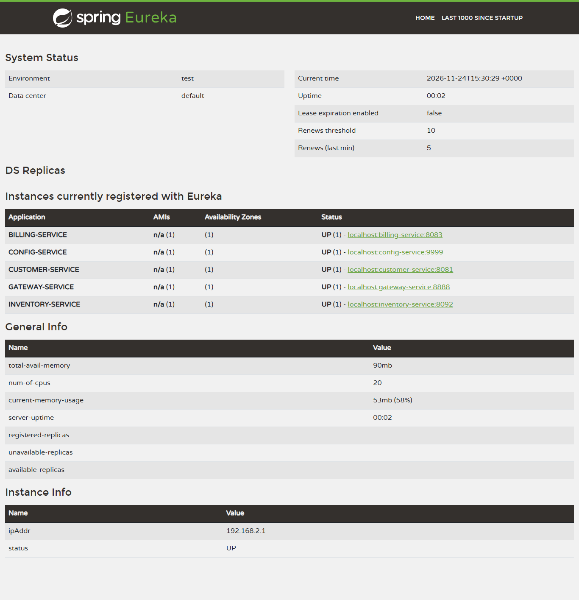

### 2. Configuration centralisée

Le serveur de configuration assemble deux fichiers pour chaque service : `application.properties`, commun à tous, et `<service>.properties`, propre au service. Un fichier `<service>-<profil>.properties` remplace les valeurs pour un profil donné.

#### Configuration de customer-service, profil par défaut

`http://localhost:9999/customer-service-default.properties`

On y retrouve les paramètres globaux (`global.params.p1`, `global.params.p2`) et ceux du service (`customer.params.x=11`, `customer.params.y=22`).

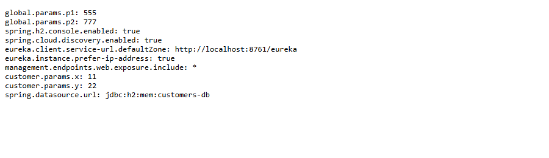

#### Configuration de customer-service, profil dev

`http://localhost:9999/customer-service-dev.properties`

Avec le profil `dev`, les valeurs de `customer.params` deviennent `66` et `29`.


#### Lecture de la configuration par le service

`customer-service` expose deux points de test qui renvoient les valeurs reçues du serveur de configuration.

`http://localhost:8081/testConfig1` — paramètres globaux, injectés avec `@Value` :

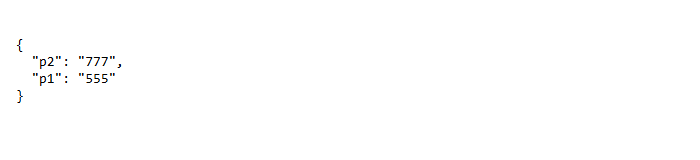

`http://localhost:8081/testConfig2` — paramètres du service, liés à un `record` avec `@ConfigurationProperties(prefix = "customer.params")` :


### 3. Front Angular : toutes les pages

La barre de navigation contient deux entrées, `Products` et `Customers`. Deux autres pages sont accessibles depuis la page `Customers`.

#### Accueil

`http://localhost:4200/`

Aucune route n'est définie pour `/` : seule la barre de navigation s'affiche.

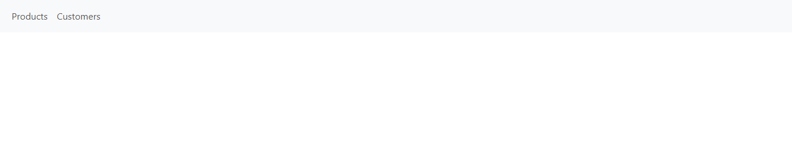

#### Products

`http://localhost:4200/products`

Liste des produits, lue sur `http://localhost:8888/products` (gateway → `inventory-service`).

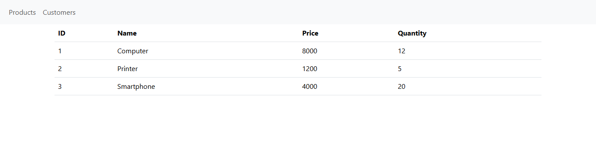

#### Customers

`http://localhost:4200/customers`

Liste des clients, lue sur `http://localhost:8888/customers` (gateway → `customer-service`). Le bouton `Bills` de chaque ligne ouvre les factures du client.

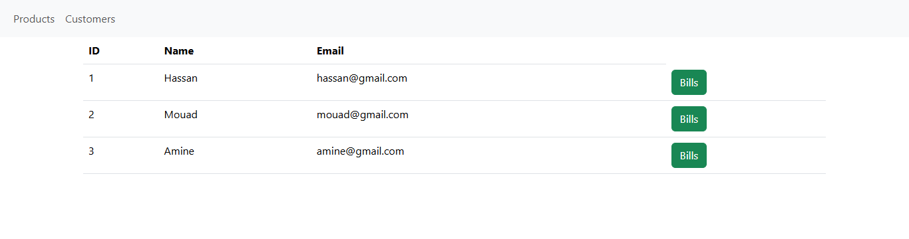

#### Bills — factures d'un client

`http://localhost:4200/bills/1`

Factures du client sélectionné, obtenues avec la recherche `bills/search/byCustomerId?customerId=1`. Le bouton `Bill Details` ouvre le détail.

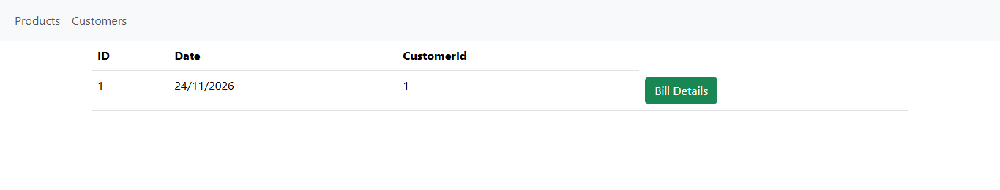

#### Bill Details — détail d'une facture

`http://localhost:4200/bill-details/1`

Détail complet d'une facture, lu sur `http://localhost:8888/fullBill/1`. À gauche les informations de la facture et du client, à droite les lignes de produits avec quantité, prix et remise. Le nom du client et le nom des produits ne sont pas stockés par `billing-service` : ils viennent des deux autres services.

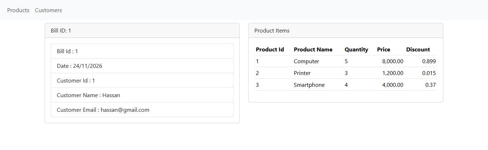

### 4. API à travers la gateway

La gateway déclare quatre routes statiques dans `application.yml` :

| Chemin | Service cible |
|---|---|
| `/customers/**` | `customer-service` |
| `/products/**` | `inventory-service` |
| `/bills/**` | `billing-service` |
| `/fullBill/**` | `billing-service` |

Elle autorise aussi les appels du front grâce à une configuration CORS globale.

#### Clients

`GET http://localhost:8888/customers`

Réponse au format HAL générée par Spring Data REST : les clients sont dans `_embedded`, avec leurs liens `_links`.

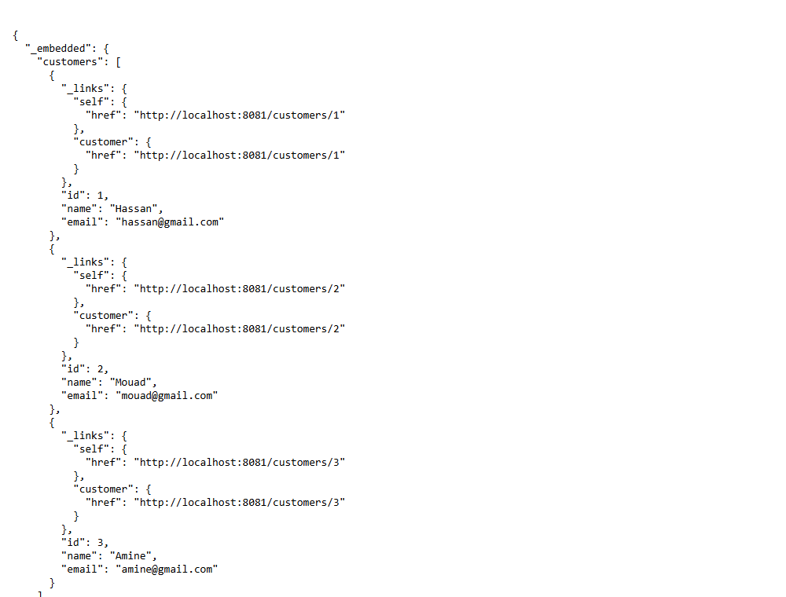

#### Produits

`GET http://localhost:8888/products`

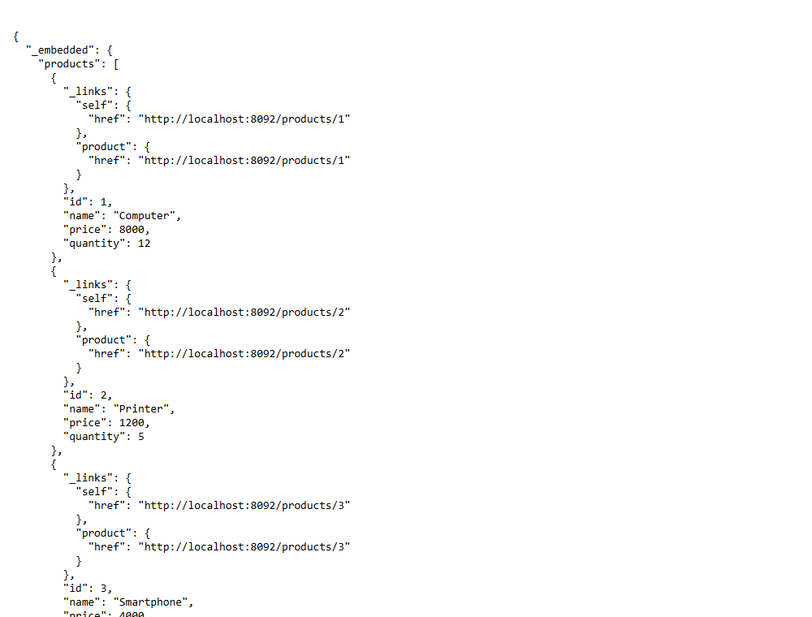

#### Factures d'un client

`GET http://localhost:8888/bills/search/byCustomerId?customerId=1`

Méthode de recherche ajoutée au repository et exposée automatiquement :

```java
@RestResource(path = "byCustomerId", rel = "byCustomerId")
List<Bill> findByCustomerId(@Param("customerId") Long customerId);
```

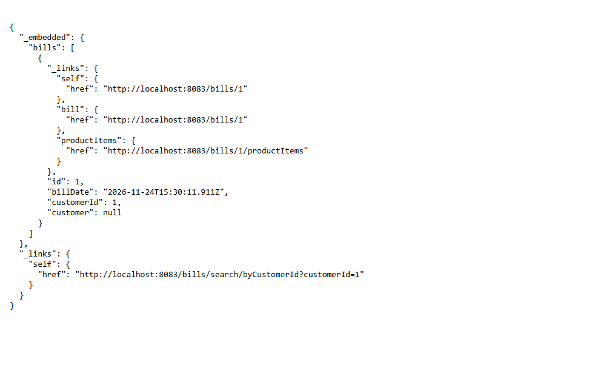

#### Facture complète

`GET http://localhost:8888/fullBill/1`

Point d'accès écrit à la main dans `BillRestController`. Il renvoie la facture avec l'objet `customer` et, pour chaque ligne, l'objet `product`.

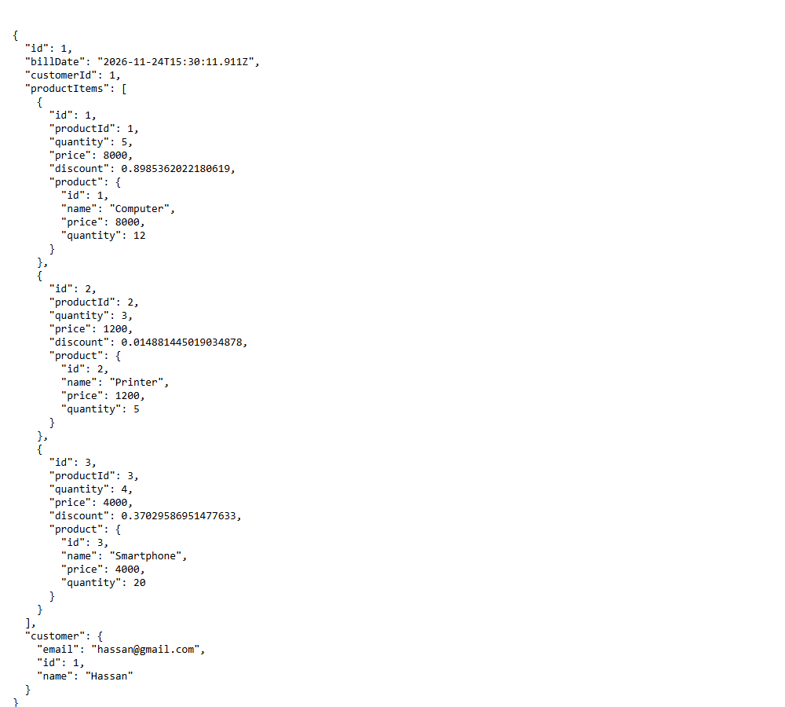

## Communication entre services

`billing-service` ne stocke que les identifiants (`customerId`, `productId`). Les objets complets sont récupérés à la demande avec deux clients OpenFeign, résolus par nom de service grâce à Eureka :

```java
@FeignClient(name = "customer-service")
public interface CustomerRestClient {
    @GetMapping(path = "/customers/{id}")
    Customer findCustomerById(@PathVariable Long id);
}

@FeignClient(name = "inventory-service")
public interface ProductRestClient {
    @GetMapping(path = "/products/{id}")
    Product findProductById(@PathVariable Long id);

    @GetMapping(path = "/products")
    PagedModel<Product> allProducts();
}
```

Au démarrage, un `CommandLineRunner` de `billing-service` vérifie que le client n°1 existe, crée une facture pour lui et y ajoute une ligne par produit du catalogue, avec une quantité et une remise aléatoires.
